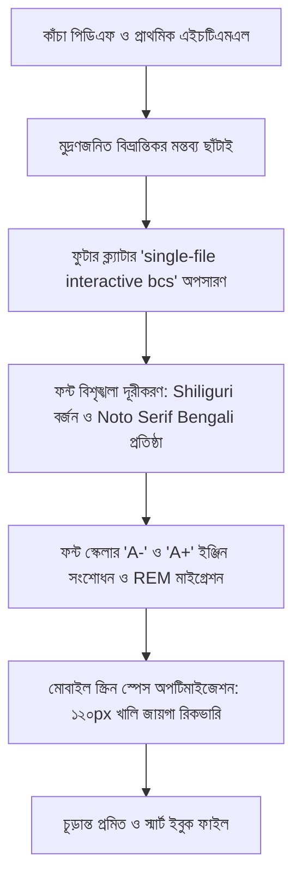

# 📖 লাইভ এমসিকিউ পূর্ণাঙ্গ ইবুক প্ল্যাটফর্ম: ডিজাইন সিস্টেম, ডাটা ক্লিনআপ ও মাল্টি-সাবজেক্ট আর্কিটেকচার
> **দলিল সংকলনের তারিখ:** ২১ অক্টোবর ২০২৬  
> **উদ্দেশ্য:** সম্পূর্ণ পিডিএফ বইকে ইন্টারঅ্যাক্টিভ, মোবাইল-বান্ধব ও আধুনিক ইবুক প্ল্যাটফর্মে রূপান্তরের স্থায়ী স্ট্যান্ডার্ড গাইড, ডাটা ক্লিনআপের ইতিহাস এবং ভবিষ্যতের সকল বিষয়ের সংযোগ রূপরেখা।

---

## 📑 সূচিপত্র (Table of Contents)
1. [ব্যবহারকারীর অনুমোদিত ডিজাইন ও ভিজ্যুয়াল দর্শন](#১-ব্যবহারকারীর-অনুমোদিত-ডিজাইন-ও-ভিজ্যুয়াল-দর্শন)
2. [ডাটা ক্লিনআপ, সংশোধন ও ফিল্টারিং হিস্ট্রি (Data Cleanup & Rectification)](#২-ডাটা-ক্লিনআপ-সংশোধন-ও-ফিল্টারিং-হিস্ট্রি)
3. [কাঁচা পিডিএফ/টেক্সট থেকে পূর্ণাঙ্গ স্মার্ট ইবুকে রূপান্তরের পাইপলাইন (Pipeline)](#৩-কাঁচা-পিডিএফটেক্সট-থেকে-পূর্ণাঙ্গ-স্মার্ট-ইবুকে-রূপান্তরের-পাইপলাইন)
4. [টাইপোগ্রাফি ও ইউনিভার্সাল ফন্ট স্কেলিং ইঞ্জিন (Typography & REM Scaler)](#৪-টাইপোগ্রাফি-ও-ইউনিভার্সাল-ফন্ট-স্কেলিং-ইঞ্জিন)
5. [কালার প্যালেট, থিম মোড ও ভিজ্যুয়াল কম্পোনেন্ট](#৫-কালার-প্যালেট-থিম-মোড-ও-ভিজ্যুয়াল-কম্পোনেন্ট)
6. [মোবাইল-ফার্স্ট রেসপনসিভ নিয়মাবলি (Samsung A23 অপটিমাইজেশন)](#৬-মোবাইল-ফার্স্ট-রেসপনসিভ-নিয়মাবলি-samsung-a23-অপটিমাইজেশন)
7. [তথ্য উপস্থাপনার আর্কিটেকচার (বোরিং টেক্সট বনাম স্মার্ট উপস্থাপন)](#৭-তথ্য-উপস্থাপনার-আর্কিটেকচার-বোরিং-টেক্সট-বনাম-স্মার্ট-উপস্থাপন)
8. [মাল্টি-সাবজেক্ট ইবুক আর্কিটেকচার ও মাস্টার ইনডেক্স কাঠামো](#৮-মাল্টি-সাবজেক্ট-ইবুক-আর্কিটেকচার-ও-মাস্টার-ইনডেক্স-কাঠামো)
9. [বাস্তব প্রয়োগ ও পরবর্তী বিষয়: বাংলাদেশ বিষয়াবলি (`Live MCQ Bangladesh`)](#৯-বাস্তব-প্রয়োগ-ও-পরবর্তী-বিষয়-বাংলাদেশ-বিষয়াবলি)
10. [নতুন বিষয় যুক্ত করার ধাপভিত্তিক চেকলিস্ট](#১০-নতুন-বিষয়-যুক্ত-করার-ধাপভিত্তিক-চেকলিস্ট)

---

## ১. ব্যবহারকারীর অনুমোদিত ডিজাইন ও ভিজ্যুয়াল দর্শন

এই প্রজেক্টের প্রতিটি পেজ কেবল একটি সাধারণ ওয়েবপেজ নয়; এটি পরীক্ষার্থীদের দীর্ঘক্ষণ পড়ার জন্য তৈরি একটি **চোখ-বান্ধব, দ্রুতগতির, রিচ-অ্যাস্থেটিক স্মার্ট ইবুক**। 

### মূল নীতিসমূহ:
* **জিরো ইনফরমেশন লস (Zero Data Loss):** মূল পিডিএফের কোনো সাহিত্যিক, ঐতিহাসিক বা ব্যাকরণগত তথ্য বাদ দেওয়া যাবে না।
* **ভিজ্যুয়াল ক্ল্যারিটি (Visual Scannability):** একগাদা হিজিবিজি টেক্সট রাখা যাবে না। প্রতিটি প্যারাগ্রাফ, তালিকা বা ছক এমনভাবে ডিজাইন করতে হবে যাতে চোখ বুলিয়েই মূল কি-ওয়ার্ড মনে রাখা যায়।
* **সর্বোচ্চ পড়ার জায়গা (Maximum Viewport Real-Estate):** হেডারে অতিরিক্ত ফাঁকা জায়গা রাখা যাবে না। মোবাইলের ছোট স্ক্রিনে যাতে মূল বিষয়বস্তু সর্বাধিক প্রাধান্য পায়।
* **অপ্রয়োজনীয় তথ্যের ছাঁটাই:** প্রশ্নব্যাংকের অপশন প্রিন্টিং ত্রুটি সংক্রান্ত অবান্তর মন্তব্য (যেমন "খ ও গ মুদ্রণপ্রমাদ") বা জেনেরিক ফুটার লাইন ("single-file interactive bcs") সম্পূর্ণ বর্জনীয়।

---

## ২. ডাটা ক্লিনআপ, সংশোধন ও ফিল্টারিং হিস্ট্রি

বর্তমান প্রজেক্টটি রূপান্তরকালে কাঁচা ডাটা এবং প্রাথমিক কোডবেস থেকে যেসব অসঙ্গতি ও অপ্রয়োজনীয় ডাটা দূর ও সংশোধন করা হয়েছে, তার বিস্তারিত বিবরণ:



### ক. পরীক্ষার প্রশ্ন ও সন্দেহ নিরসন টেবিলে মুদ্রণজনিত বিতর্ক বাদ দেওয়া
* **সমস্যা:** মূল পিডিএফ বা প্রশ্নব্যাংকের নোটে প্রায়ই ছিল: *"খ ও গ মুদ্রণপ্রমাদ"*, *"ক সঠিক হলেও মুদ্রণজনিত কারণে বোর্ড গ ধরেছে"*, *"খ ও ঘ উভয়ই হতে পারে মুদ্রণ ভুলের কারণে"* ইত্যাদি। 
* **কেন বাদ দেওয়া হলো:** বিসিএস ও চাকরিপ্রার্থীদের জন্য বইয়ের ছাপার ভুল বা মুদ্রণ প্রমাদ সম্পর্কিত বিতর্ক কোনো কাজে আসে না, বরং বিভ্রান্তি ও অযথা মেমোরি লোড বাড়ায়।
* **গৃহীত সিদ্ধান্ত ও সমাধান:**
  1. পুরো প্রজেক্টের প্রতিটি অধ্যায় স্ক্যান করে মুদ্রণজনিত (ক, খ, গ, ঘ সংক্রান্ত) সকল অপ্রয়োজনীয় মন্তব্য ও বিতর্কিত কলাম সম্পূর্ণ মুছে ফেলা হয়েছে।
  2. "সন্দেহ নিরসন ও সঠিক সমাধান" টেবিলে শুধুমাত্র **প্রমাণিত সঠিক উত্তর**, **বোর্ড/পিএসসি কর্তৃক গৃহীত স্ট্যান্ডার্ড তথ্য** এবং **১-২ লাইনের খাঁটি ব্যাখ্যা** সংরক্ষণ করা হয়েছে।

### খ. অবাঞ্ছিত ফুটার লাইন (`single-file interactive bcs`) ছাঁটাই
* **সমস্যা:** প্রাথমিক রূপান্তরের সময় প্রতিটি ফাইলের নিচে স্বয়ংক্রিয়ভাবে একটি টেক্সট লাইন যুক্ত ছিল: `single-file interactive bcs`।
* **সমাধান:** মোবাইল ও ডেসকটপ উভয় ভিউতে বিভ্রান্তি দূর করতে অটোমেটেড স্ক্রিপ্টের মাধ্যমে প্রজেক্টের ৩১টি ফাইল থেকেই এই লাইনটি সম্পূর্ণ মুছে দেওয়া হয়েছে।

### গ. সাইটেশন ও জেনেরিক রেফারেন্স ব্র্যাকেট পরিষ্কার করা
* **সমস্যা:** উইকিপিডিয়া বা র টেক্সট কালেকশনের কারণে টেক্সটের ভেতরে `[১]`, `[২]`, `[তথ্যসূত্র প্রয়োজন]` টাইপের অপ্রয়োজনীয় সাইটেশন ট্যাগ ছিল।
* **সমাধান:** টেক্সটের পড়ার সাবলীলতা অক্ষুণ্ণ রাখতে এই ধরনের সব স্কয়ার-ব্র্যাকেট সাইটেশন স্বয়ংক্রিয় রেজেক্স প্রক্রিয়ায় ক্লিন করা হয়েছে।

### ঘ. ফন্ট বিশৃঙ্খলা ও সিএসএস কনফ্লিক্ট নিরসন
* **সমস্যা:** পূর্বে বিভিন্ন ফাইলে বিভিন্ন ফন্ট (`Shiliguri`, নানারকম লোকাল ফন্ট) কল করা ছিল এবং ফন্ট সাইজ ছিল ফিক্সড পিক্সেল (`px`)।
* **সমাধান:**
  1. `Shiliguri` ফন্ট সম্পূর্ণভাবে নিষিদ্ধ ও প্রজেক্ট থেকে অপসারিত।
  2. একমাত্র অনুমোদিত বাংলা ওয়েবফন্ট হিসেবে Google Fonts-এর `Noto Serif Bengali` (৪০০ থেকে ৮০০ ওয়েট) প্রমিত করা হয়েছে।
  3. সমস্ত ফন্ট সাইজকে `px` থেকে `rem` এককে রূপান্তর করা হয়েছে, যা ডায়নামিক স্কেলিংয়ের মূল শর্ত।

### ঙ. ফন্ট স্কেলিং ইঞ্জিন সংশোধন (`A-` / `A+` বাটন ফিক্স)
* **সমস্যা:** পূর্বে মোবাইল ফোনে `A-` এবং `A+` বাটনে চাপলে লেখার আকার ছোট বা বড় হতো না, কারণ কোডে কিছু লোকাল ফাংশন এবং সিএসএস ভ্যারিয়েবল বিচ্ছিন্ন অবস্থায় ছিল যা ফিক্সড পিক্সেল ফন্টকে স্কেল করতে পারত না।
* **স্থায়ী সমাধান:**
  1. রুট এলিমেন্ট স্কেলিং: `document.documentElement.style.fontSize` পরিবর্তনের মাধ্যমে সেন্ট্রাল স্কেলিং চালু করা হয়েছে।
  2. মেমোরি পারসিস্টেন্স: `localStorage.getItem('ebk_font_scale')` যুক্ত করা হয়েছে, যার ফলে পাঠক একবার ফন্ট সাইজ বাড়ালে পরবর্তী অধ্যায়ে গেলেও সেই সাইজ কার্যকর থাকে।
  3. সিএসএসের প্রতিটি ফন্ট সাইজকে `rem` ইউনিটে সেট করা হয়েছে।

### চ. মোবাইল স্ক্রিন স্পেস অপটিমাইজেশন (Samsung A23 কেস স্টাডি)
* **বাস্তব সমস্যা:** Samsung A23 ফোনে টেস্ট করার সময় দেখা যায়:
  1. বঙ্কিমচন্দ্র পেজের উপরের হিরো ব্যানার ও স্টাডি ফ্লো কার্ড অতিরিক্ত উচ্চতা দখল করায় লেখার মূল অংশে পৌঁছাতে দীর্ঘ স্ক্রল করতে হতো এবং হেডার ডানে কেটে যেত।
  2. কনটেইনারের উভয় পাশে প্রায় ৬০px করে মোট ১২০px খালি জায়গা অপচয় হচ্ছিল, ফলে লেখার জায়গা অনেক সরু হয়ে পড়েছিল।
* **গৃহীত সংস্কারসমূহ:**
  1. **হেডার কাটাকাটি সমাধান:** মোবাইলে অপ্রয়োজনীয় `🖨️ প্রিন্ট` বাটনটি `@media (max-width: 600px)` দিয়ে লুকানো হয়েছে। ফলে বাকি ৪টি বাটন সুন্দরভাবে এক সারিতে ফিট হয়েছে।
  2. **দুই পাশের খালি জায়গা রিকভারি:** `.container` প্যাডিং কমিয়ে `6px 8px 24px 8px` করা হয়েছে। এর ফলে স্ক্রিনের ৯৮% প্রস্থই সরাসরি পড়ার কাজে ব্যবহৃত হচ্ছে।
  3. **হিরো ব্যানার ও স্টাডি ফ্লো ৬০% সংকোচন:** হিরো সেকশনের প্যাডিং কমিয়ে কমপ্যাক্ট করা হয়েছে এবং ৪টি বড় কার্ডের বদলে মোবাইল ভিউতে ২-কলামের কমপ্যাক্ট গ্রিড বসানো হয়েছে।

---

## ৩. কাঁচা পিডিএফ/টেক্সট থেকে পূর্ণাঙ্গ স্মার্ট ইবুকে রূপান্তরের পাইপলাইন

ভবিষ্যতে যেকোনো বিষয়ের পিডিএফ বা টেক্সট ফাইলকে এই প্রজেক্টের সমমানের স্মার্ট ইবুকে রূপান্তর করার ক্ষেত্রে নিচের ৭-ধাপের পাইপলাইন হুবহু অনুসরণ করতে হবে:

```text
[কাঁচা পিডিএফ / টেক্সট]
         │
         ▼
[ধাপ ১: টেক্সট নিষ্কাশন ও অধ্যায়ভিত্তিক বিভাজন (Chunking by Topic)]
         │
         ▼
[ধাপ ২: ডাটা স্যানিটাইজেশন ও অপ্রয়োজনীয় তথ্য ছাঁটাই (Data Cleanup)]
         │
         ▼
[ধাপ ৩: কনটেন্ট স্মার্টফিকেশন (Table, Matrix, Quotes, Doubt Box)]
         │
         ▼
[ধাপ ৪: স্ট্যান্ডার্ড টাইপোগ্রাফি ও থিম প্রয়োগ (Noto Serif Bengali + REM)]
         │
         ▼
[ধাপ ৫: গ্লোবাল কম্পোনেন্ট যুক্তকরণ (nav-component.js Linkage)]
         │
         ▼
[ধাপ ৬: মোবাইল-ফার্স্ট অডিট ও রেসপনসিভনেস পরীক্ষা (Samsung A23 Standards)]
         │
         ▼
[ধাপ ৭: সাবজেক্ট ইনডেক্স ও মাস্টার লাইব্রেরি পোর্টালে ম্যাপিং]
```

### ধাপ ১: টেক্সট নিষ্কাশন ও কাঠামোগত বিভাজন
* পিডিএফ থেকে ওসিআর (OCR) বা টেক্সট এক্সট্রাকশনের পর প্রতিটি টপিক বা অধ্যায়কে পৃথক একক এইচটিএমএল ফাইলে ভাগ করতে হবে (যেমন: `চর্যাপদ.html`, `বঙ্কিমচন্দ্র চট্টোপাধ্যায়.html`)।
* ফাইলের নামকরণে স্পষ্ট বাংলা ইউনিকোড নাম ব্যবহার করতে হবে।

### ধাপ ২: ডাটা স্যানিটাইজেশন ও অপ্রয়োজনীয় তথ্য ছাঁটাই
* প্রশ্নব্যাংকের অপশন মুদ্রণপ্রমাদ (ক/খ/গ/ঘ বিষয়ক জটিলতা) টেবিল থেকে ছেঁটে ফেলতে হবে।
* জেনেরিক ট্যাগ, স্কয়ার ব্র্যাকেট সাইটেশন (`[১]`, `[২]`), ওয়াটারমার্ক বা অবান্তর ফুটার লাইন (যেমন `single-file interactive bcs`) সম্পূর্ণ অপসারিত করতে হবে।

### ধাপ ৩: তথ্য রূপান্তর ও স্মার্ট ভিজ্যুয়ালাইজেশন (Zero Data Loss)
কাঁচা অনুচ্ছেদকে কখনোই একগাদা হিজিবিজি টেক্সট আকারে রাখা যাবে না। নিচের নিয়মে কনভার্ট করতে হবে:
1. **উপন্যাস/গ্রন্থ ও চরিত্র:** `চরিত্র-ম্যাট্রিক্স ছক` (গ্রন্থে নাম | প্রকাশকাল | কেন্দ্রীয় চরিত্রসমূহ | বিশেষত্ব)।
2. **বিখ্যাত উক্তি ও চরণ:** `উক্তি কার্ড` (উক্তি | কোন গ্রন্থ থেকে সংগৃহীত | কোন চরিত্রের সংলাপ)।
3. **গুরুত্বপূর্ণ সাল ও ঘটনা:** `কালানুক্রমিক টাইমলাইন` বা `ফ্লো-স্টেপস`।
4. **পরীক্ষার বিভ্রান্তিকর তথ্য:** ৩ কলামের `সন্দেহ নিরসন টেবিল` (বিভ্রান্তিকর তথ্য | সঠিক উত্তর | নির্ভরযোগ্য প্রমাণ)।
5. **বিসিএস ও অন্যান্য পরীক্ষার প্রশ্নব্যাংক:** ইন্টারঅ্যাক্টিভ কুইজ কার্ড (`.quiz-card`) উইথ ইনস্ট্যান্ট ফিডব্যাক ও রিচ এক্সপ্ল্যানেশন।

### ধাপ ৪: টাইপোগ্রাফি ও স্টাইলিং স্ট্যান্ডার্ডাইজেশন
* ফন্ট লিঙ্ক যুক্ত করতে হবে:
  ```html
  <link rel="preconnect" href="https://fonts.googleapis.com">
  <link rel="preconnect" href="https://fonts.gstatic.com" crossorigin>
  <link href="https://fonts.googleapis.com/css2?family=Noto+Serif+Bengali:wght@400;500;600;700;800&display=swap" rel="stylesheet">
  ```
* কোনো অবস্থাতেই `Shiliguri` ব্যবহার করা যাবে না।
* সমস্ত ফন্ট সাইজকে `rem` এককে লিখতে হবে (যেমন: `font-size: 1rem;`, `font-size: 0.95rem;`)।

### ধাপ ৫: শেয়ার্ড কম্পোনেন্ট (`nav-component.js`) সংযুক্তিকরণ
* প্রতিটি ফাইলের `</body>` ট্যাগের ঠিক পূর্বে স্ক্রিপ্ট ট্যাগ যুক্ত করতে হবে:
  ```html
  <script src="../shared/js/nav-component.js"></script>
  <!-- অথবা একই ফোল্ডারে থাকলে -->
  <script src="nav-component.js"></script>
  ```
* এই স্ক্রিপ্ট স্বয়ংক্রিয়ভাবে টপবার, ফন্ট স্কেলার বাটন (`A-`, `A+`), ডার্ক/লাইট মোড টগলার, প্রগ্রেস ট্র্যাকার এবং সাইডবার ড্রয়ার ইনজেক্ট করবে।

### ধাপ ৬: মোবাইল-ফার্স্ট অডিট (Samsung A23 Standards)
* স্ক্রিন প্রস্থ ৩৬০px থেকে ৪১২px-এ টেস্ট করতে হবে:
  1. ডানে-বামে কোনো অবাঞ্ছিত সাদা ফাঁকা জায়গা (Horizontal Scrollbar) আছে কি না।
  2. কনটেইনারের সাইড প্যাডিং সর্বোচ্চ `8px` করা আছে কি না।
  3. মোবাইলে `🖨️ প্রিন্ট` বাটন লুকানো এবং কন্ট্রোল বাটন এক লাইনে ফিট হয়েছে কি না।
  4. টেবিলগুলোতে স্মুথ টাচ স্ক্রল কাজ করছে কি না।
  5. `A-` এবং `A+` বাটনে ক্লিক করলে লেখার সাইজ সুষমভাবে ছোট-বড় হচ্ছে কি না।

### ধাপ ৭: সাবজেক্ট ইনডেক্স ও মাস্টার পোর্টালে ম্যাপিং
* বিষয়ের নিজস্ব সূচিপত্র ফাইলে (`index.html`) নতুন অধ্যায়ের কার্ড যুক্ত করতে হবে।
* রুট মাস্টার পোর্টাল (`/index.html`)-এর ডাটাবেজে অধ্যায় সংখ্যা ও পৃষ্ঠার হিসাব আপডেট করতে হবে।

---

## ৪. টাইপোগ্রাফি ও ইউনিভার্সাল ফন্ট স্কেলিং ইঞ্জিন

### ক. ফন্ট চয়েস
* **অনুমোদিত ফন্ট:** `Noto Serif Bengali` (Google Fonts: weights 400, 500, 600, 700, 800)।
* **ফলব্যাক ফন্ট:** `'Kalpurush', Vrinda, serif, sans-serif`।
* **কঠোর নিষেধাজ্ঞা:** কোনো ফাইলে `Shiliguri` ফন্ট ব্যবহার করা যাবে না।

### খ. ইউনিট স্ট্যান্ডার্ড (১০০% REM রুল)
* সিএসএসে ফন্ট সাইজের জন্য **কখনোই ফিক্সড পিক্সেল (`px`) ব্যবহার করা যাবে না**।
* প্রতিটি ফন্ট সাইজকে `rem` এককে লিখতে হবে:
  * মূল বডি টেক্সট: `1rem` (১৬px এর সমতুল্য)
  * ক্যাপশন ও মেটাডাটা: `0.85rem` – `0.9rem`
  * সেকশন হেডিং (H2): `1.35rem` – `1.5rem`
  * কার্ড টাইটেল (H3): `1.15rem` – `1.25rem`

### গ. সেন্ট্রাল ফন্ট স্কেলার মেকানিজম (`A-` / `A+`)
* **স্কেলিং লজিক:** রুট `document.documentElement.style.fontSize` পরিবর্তনের মাধ্যমে স্কেল করা হয় (৮০% থেকে ১৪০% পর্যন্ত, প্রতি ক্লিকে ৮% পরিবর্তন)।
* **মেমোরি সংরক্ষণ (`localStorage`):** ব্যবহারকারী কোনো একটি পেজে ফন্ট সাইজ বাড়ালে বা কমালে তা `localStorage.getItem('ebk_font_scale')`-এ সংরক্ষিত থাকে এবং পরবর্তী সব পেজে স্বয়ংক্রিয়ভাবে কার্যকর হয়।
* **গ্লোবাল হ্যান্ডলার রুটিন (`nav-component.js`):**
  ```javascript
  window.adjustFontSize(delta); // delta: 0.08 বা -0.08
  window.changeFontSize(delta); // delta: 1 (বড়), -1 (ছোট), 0 (রিসেট)
  window.ebkAdjustFontSize(delta); // ড্রয়ারের জন্য
  window.ebkResetFontSize(); // ১০০% স্বাভাবিক সাইজে রিসেট
  ```

---

## ৫. কালার প্যালেট, থিম মোড ও ভিজ্যুয়াল কম্পোনেন্ট

### ক. থিম কালার সিস্টেম
| টোকেন নাম | লাইট মোড (Light) | ডার্ক মোড (Dark) | উদ্দেশ্য |
|:---|:---|:---|:---|
| `--bg-base` | `#f9f8f6` (পার্চমেন্ট সফট) | `#0f0b0c` / `#18052e` | পেজের মূল ব্যাকগ্রাউন্ড |
| `--bg-surface` | `#ffffff` | `#1a1215` / `#2c0b4d` | কার্ড ও সেকশন ব্যাকগ্রাউন্ড |
| `--text-main` | `#1c1917` / `#2e1065` | `#f8fafc` / `#faf5ff` | পড়ার মূল টেক্সট (উচ্চ কনট্রাস্ট) |
| `--primary` | `#881337` / `#701a75` | `#fb7185` / `#f0abfc` | হেডার, ব্র্যান্ডিং ও অ্যাকসেন্ট |
| `--border-color` | `#e4d8cc` / `#f0abfc` | `#3b282e` / `#86198f` | মার্জিত বর্ডারলাইন |

### খ. ভিজ্যুয়াল কম্পোনেন্টসমূহ
1. **স্মার্ট টেবিল (`.table-responsive`):**
   * গ্রেডিয়েন্ট বা ডার্ক প্রিমিয়াম হেডার (`background: linear-gradient(135deg, var(--primary), #9f1239); color: #fff;`)।
   * অল্টারনেট রো স্ট্রাইপিং (`:nth-child(even)` হালকা টিন্ট)।
   * সেল প্যাডিং: ডেসকটপে `12px 14px`, মোবাইলে `7px 6px`।
2. **সন্দেহ নিরসন ও সঠিক সমাধান বক্স (`.doubt-box`):**
   * বর্ডার-লেফট হাইলাইট (`border-left: 5px solid #e11d48;`)।
   * ৩টি নির্দিষ্ট কলাম: *বিভ্রান্তিকর তথ্য*, *পরীক্ষার সঠিক উত্তর*, *প্রমাণ ও ব্যাখ্যা*।
3. **স্মার্ট কুইজ কার্ড (`.quiz-card`):**
   * ইন্টারেক্টিভ অপশন বাটন (`.opt-btn`): হোভার অ্যানিমেশন এবং টাচ রেসপন্সিভ।
   * তাৎক্ষণিক ফিডব্যাক: সঠিক হলে সবুজ (`background: var(--success-light)`), ভুল হলে লাল।
   * পূর্ণাঙ্গ রেফারেন্সযুক্ত ব্যাখ্যা বক্স (`.quiz-explanation`)।

---

## ৬. মোবাইল-ফার্স্ট রেসপনসিভ নিয়মাবলি (Samsung A23 অপটিমাইজেশন)

স্মার্টফোনে (স্ক্রিন প্রস্থ ৩৬০px – ৪১২px) পড়ার অভিজ্ঞতা নিখুঁত রাখার জন্য নিচের সিএসএস আর্কিটেকচার প্রতিটি ফাইলে বজায় রাখতে হবে:

```css
@media (max-width: 600px) {
  /* ১. হেডার ও বাটন অপটিমাইজেশন */
  .print-btn { 
    display: none !important; /* মোবাইলে অপ্রয়োজনীয় প্রিন্ট বাটন লুকানো */
  }
  .site-header { 
    padding: 6px 8px !important; 
  }
  .brand-title { 
    max-width: 120px; 
    text-overflow: ellipsis; 
    white-space: nowrap; 
    overflow: hidden; 
  }

  /* ২. দুই পাশের খালি জায়গা দূরীকরণ (Lateral Space Recovery) */
  .container { 
    padding: 6px 8px 24px 8px !important; 
  }
  .study-section, .card, .author-card { 
    padding: 12px 10px !important; 
    border-radius: 8px !important; 
  }

  /* ৩. হিরো ব্যানার ও স্টাডি ফ্লো সংকোচন */
  .hero-banner, .intro-hero { 
    padding: 16px 12px !important; 
    margin-top: 8px !important; 
    margin-bottom: 14px !important; 
  }
  .study-flow-grid { 
    grid-template-columns: repeat(2, 1fr) !important; 
    gap: 8px !important; 
  }

  /* ৪. টেবিল মোবাইল ফ্রেন্ডলি প্যাডিং */
  .table-responsive table th, 
  .table-responsive table td { 
    padding: 7px 6px !important; 
  }
}
```

---

## ৭. তথ্য উপস্থাপনার আর্কিটেকচার (বোরিং টেক্সট বনাম স্মার্ট উপস্থাপন)

| তথ্যের ধরন | সাধারণ উপস্থাপনা (বর্জনীয় ❌) | স্মার্ট উপস্থাপনা (ব্যবহারকারীর পছন্দ ✅) |
|:---|:---|:---|
| উপন্যাসের নাম ও চরিত্র | দীর্ঘ টানা অনুচ্ছেদ | **চরিত্র-ম্যাট্রিক্স টেবিল** (উপন্যাস \| প্রকাশকাল \| কেন্দ্রীয় চরিত্রসমূহ) |
| উক্তি ও সংলাপ | কমা দিয়ে লেখা তালিকা | **উক্তি কার্ড / কোট বক্স** (উক্তি \| কার রচনা \| কোন চরিত্রের সংলাপ) |
| আত্মজীবনী ও ভ্রমণকাহিনী | এলোমেলো বুলেট পয়েন্ট | **কালানুক্রমিক টাইমলাইন বা ফ্লোচার্ট** |
| বিগত বিসিএস ট্রেন্ড | শুধু লিখিত বিবরণ | **স্ট্যাট চিপস ও মেট্রিক্স গ্রিড** (৪৭তম বিসিএস: ১টি, ৪৬তম: ২টি ইত্যাদি) |
| বিভ্রান্তিকর বা অসঙ্গতিপূর্ণ প্রশ্ন | মুদ্রণপ্রমাদের মন্তব্যযুক্ত বড় অনুচ্ছেদ | **সন্দেহ নিরসন কম্প্যারিসন টেবিল** (প্রমাণিত নির্ভুল উত্তর ও যুক্তি) |

---

## ৮. মাল্টি-সাবজেক্ট ইবুক আর্কিটেকচার ও মাস্টার ইনডেক্স কাঠামো

বর্তমানে বাংলা সাহিত্যের রূপান্তর সম্পন্ন হয়েছে। সম্পূর্ণ পিডিএফ বইটি বহু বিষয়ের সমন্বয়ে গঠিত। প্রতিটি বিষয়ের নিজস্ব ফোল্ডার ও সূচিপত্র থাকবে এবং সবার উপরে থাকবে একটি **সেন্ট্রাল মাস্টার পোর্টাল ইনডেক্স**।

### ক. সার্বিক প্রজেক্ট ডিরেক্টরি কাঠামো (Master Architecture)
```text
Live MCQ EBook Platform (site-doict/live-mcq)     <--- 🏛️ রুট মাস্টার রিপোজিটরি
│
├── index.html                                    <--- 🏛️ কেন্দ্রীয় মাস্টার পোর্টাল (সব বিষয়ের মূল প্রবেশদ্বার)
├── README.md                                     <--- প্রজেক্ট পরিচিতি ও গিটহাব গাইড
├── PROJECT_STANDARDS_AND_ARCHITECTURE.md         <--- এই স্থায়ী ডিজাইন ও আর্কিটেকচার গাইড
│
├── 📂 Live MCQ Bangla Language/                   <--- ✍️ বিষয় ১: বাংলা ভাষা ও ব্যাকরণ (২৩টি অধ্যায়, পৃষ্ঠা ১-৭৩)
│   ├── index.html                                <--- বিষয়ভিত্তিক সূচিপত্র ও ড্যাশবোর্ড
│   ├── nav-component.js                          <--- ড্রয়ার, টপবার ও ফন্ট স্কেলার
│   └── ...
│
├── 📂 Live MCQ Bangla Literature/                <--- 📘 বিষয় ২: বাংলা সাহিত্য (৩১টি অধ্যায়, পৃষ্ঠা ৭৩-২০২)
│   ├── index.html                                <--- বাংলা সাহিত্যের অধ্যায়ভিত্তিক ড্যাশবোর্ড
│   ├── nav-component.js                          <--- বাংলা সাহিত্যের ড্রয়ার, টপবার ও ফন্ট স্কেলার
│   ├── বঙ্কিমচন্দ্র চট্টোপাধ্যায়.html
│   ├── রবীন্দ্রনাথ ঠাকুর.html
│   └── ... (বাকি ২৯টি বিষয় ফাইল)
│
├── 📂 Live MCQ Bangladesh/                       <--- 📕 বিষয় ৩: বাংলাদেশ বিষয়াবলি (৩২টি অধ্যায়, পৃষ্ঠা ৪০১-৫৬৪)
│   ├── index.html                                <--- বাংলাদেশ বিষয়াবলির সূচিপত্র
│   ├── nav-component.js                          <--- বাংলাদেশ বিষয়াবলির ড্রয়ার ও নেভিগেশন
│   ├── প্রাচীন কাল (ইতিহাস, জনপদ ও বিভিন্ন রাজবংশ).html
│   ├── মুক্তিযুদ্ধ_৪৩০-৪৪৪.html
│   └── ... (বাকি ৩০টি বিষয় ফাইল)
│
├── 📂 Live MCQ International/                    <--- 🌐 বিষয় ৪: আন্তর্জাতিক বিষয়াবলি (২১টি অধ্যায়, পৃষ্ঠা ৫৮৫-৬৯৮)
│   ├── index.html                                <--- আন্তর্জাতিক বিষয়াবলির সূচিপত্র
│   ├── nav-component.js                          <--- আন্তর্জাতিক বিষয়াবলির ড্রয়ার ও নেভিগেশন
│   └── ...
│
├── 📂 Live MCQ English/                          <--- 📗 বিষয় ৩: ইংরেজি ভাষা ও সাহিত্য (পরবর্তী বিষয়)
│   ├── index.html
│   └── ...
│
├── 📂 Live MCQ Science/                          <--- 🔬 বিষয় ৪: সাধারণ বিজ্ঞান ও তথ্যপ্রযুক্তি (ভবিষ্যত বিষয়)
│   ├── index.html
│   └── ...
│
└── 📂 Live MCQ Math/                             <--- 📐 বিষয় ৫: গাণিতিক যুক্তি ও মানসিক দক্ষতা
    ├── index.html
    └── ...
```

---

## ৯. বাস্তব প্রয়োগ: বাস্তবায়িত বাংলাদেশ বিষয়াবলি (`Live MCQ Bangladesh`)

বাংলা সাহিত্যের সাফল্যের পর দ্বিতীয় বিষয় **বাংলাদেশ বিষয়াবলি** (পৃষ্ঠা ৪০১–৫৬৪, ৩২টি অধ্যায়) সম্পূর্ণ স্ট্যান্ডার্ড মেনে সফলভাবে একীভূত করা হয়েছে।

### এই বিষয়ে বাস্তবায়িত সংস্কারসমূহ:
1. **ডাটা স্যানিটাইজেশন ও ক্লিনআপ:**
   * ২,৯২৯টি অনাবশ্যক `[cite: ...]` ট্যাগ অপসারিত।
   * ৯৪টি অপশন মুদ্রণপ্রমাদের অবান্তর মন্তব্য মুছে ফেলে কেবল ৬৬টি প্রকৃত ধারণাগত বিভ্রান্তি ও পিএসসি গৃহীত সঠিক উত্তর সংরক্ষণ করা হয়েছে।
   * ফুটারের ক্ল্যাটার লাইন সম্পূর্ণ মুক্ত।
2. **ফন্ট স্ট্যান্ডার্ডাইজেশন ও ইউনিভার্সাল স্কেলিং:**
   * Google Fonts `Noto Serif Bengali` প্রমিতকরণ।
   * সমস্ত ফন্ট সাইজ `px` থেকে `rem` ইউনিটে রূপান্তর এবং `A-` ও `A+` বাটনে গ্লোবাল সিঙ্ক কার্যকর।
3. **কম্পোনেন্ট ও ড্রয়ার ইন্টিগ্রেশন:**
   * ৩২টি অধ্যায়েই `nav-component.js` যুক্ত।
   * ড্রয়ারে ইনস্ট্যান্ট বিষয় পরিবর্তনের অপশন কার্যকর।
4. **Samsung A23 মোবাইল স্পেস রিকভারি:**
   * সাইড প্যাডিং ৮px, হেডার স্পেস অপটিমাইজেশন ও কমপ্যাক্ট গ্রিড প্রয়োগ।
5. **মাস্টার পোর্টাল লিঙ্কিং:**
   * রুট `index.html`-এর সেন্ট্রাল সার্চ এবং অধ্যায় তালিকায় যুক্ত।

---

## ১০. নতুন বিষয় যুক্ত করার ধাপভিত্তিক চেকলিস্ট

ভবিষ্যতে যখনই নতুন বিষয়ের পিডিএফ কনভার্ট করবেন, তখন নিচের চেকলিস্ট মিলিয়ে নেবেন:

- [ ] ১. ফোল্ডারের নাম প্রাতিষ্ঠানিক স্ট্যান্ডার্ডে রাখা হয়েছে (যেমন: `bangladesh-affairs` বা `bangla-grammar`)।
- [ ] ২. প্রশ্নব্যাংক থেকে মুদ্রণজনিত বিতর্ক (খ ও গ / ক ও ঘ সংক্রান্ত মুদ্রণ ভুল মন্তব্য) ছেঁটে ফেলা হয়েছে।
- [ ] ৩. জেনেরিক ফুটার (`single-file interactive bcs`) সম্পূর্ণ অপসারিত হয়েছে।
- [ ] ৪. ফন্টে শুধুমাত্র `Noto Serif Bengali` ব্যবহৃত হয়েছে এবং `Shiliguri` সম্পূর্ণ বর্জিত।
- [ ] ৫. সিএসএসে কোনো ফন্ট সাইজে `px` নেই, সব জায়গায় `rem` ইউনিট ব্যবহৃত।
- [ ] ৬. টপবার বা বাটনে `nav-component.js` সংযুক্ত এবং `A-` / `A+` বাটন কাজ করছে।
- [ ] ৭. মোবাইলে (Samsung A23 বা ৩৬০px) দুই পাশের ১২০px খালি জায়গা রিকভার করে প্যাডিং ৮px করা হয়েছে।
- [ ] ৮. বোরিং প্যারাগ্রাফের বদলে তথ্যকে টেবিল, চরিত্র-ম্যাট্রিক্স ও সন্দেহ নিরসন বক্সে রূপান্তর করা হয়েছে (Zero Data Loss বজায় রেখে)।
- [ ] ৯. অধ্যায়ভিত্তিক ইনডেক্স ও মূল মাস্টার পোর্টালে বিষয়ের কার্ড যুক্ত করা হয়েছে।

---
**এই ডকুমেন্টটি আপনার ইবুক প্ল্যাটফর্মের প্রতিটি বিষয়ের "একমাত্র সত্য নির্দেশক" (Single Source of Truth) হিসেবে কাজ করবে।** 🎯
